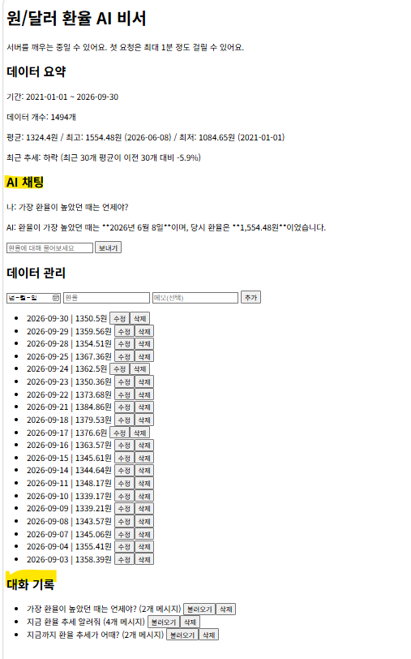
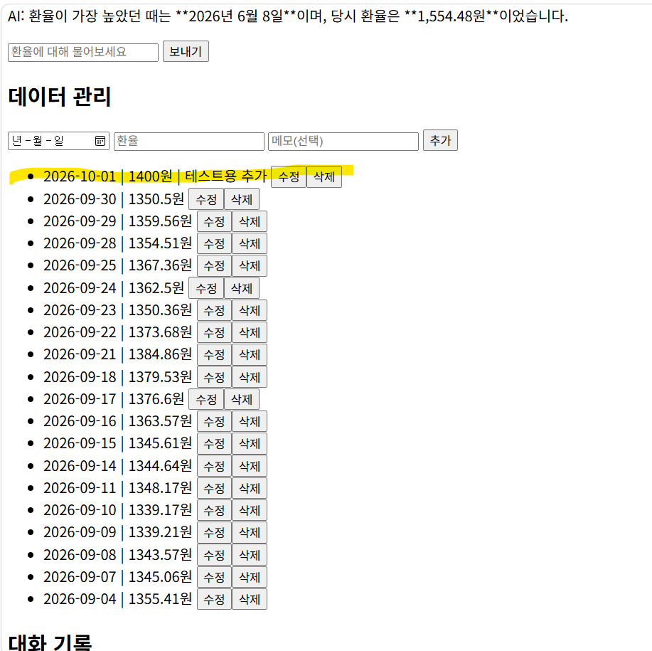
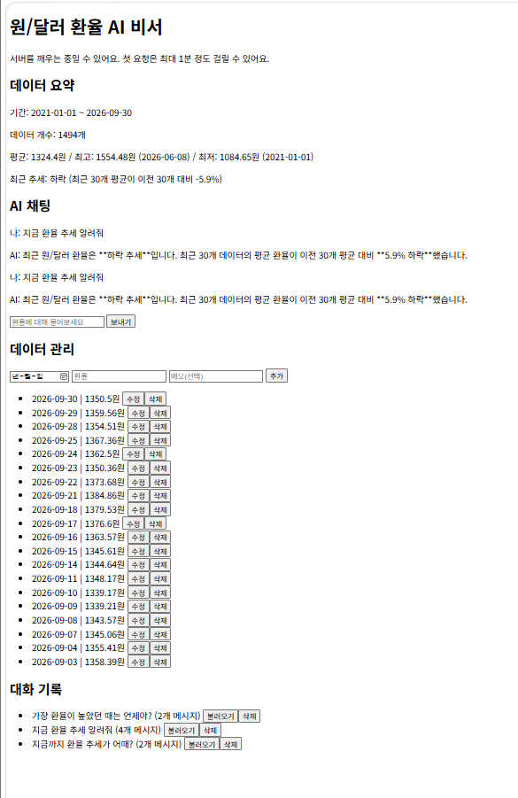

# 원/달러 환율 AI 비서

내 데이터를 아는 AI 챗봇 서비스입니다. 일반 챗봇은 "최근 환율 추세가 어때?"라고 물어도 일반적인 답만 합니다.
이 서비스는 **원/달러 환율 시계열 데이터(2021-01-01 ~ 2026-09-30, 1,494개)** 를 분석한 요약(기간, 개수, 평균·최대·최소, 최근 추세)을
AI의 시스템 프롬프트에 주입해, 저장된 데이터에 근거한 맞춤형 답변을 제공합니다.

## 주요 기능
- **데이터 기반 AI 채팅**: 질문 → 데이터 요약 조회 → 시스템 프롬프트에 삽입 → AI 호출 → 대화 자동 저장
- **데이터 관리(CRUD)**: (date, value, memo) 추가 / 조회 / 수정 / 삭제
- **대화 기록**: 대화 저장, 목록 조회, 불러오기, 삭제
- **데이터 요약**: 기간, 개수, 평균·최대·최소, 최근 추세(최근 30개 평균 vs 이전 30개 평균)

## 기술 스택
| 구분 | 사용 기술 |
|---|---|
| 백엔드 | Python 3.13, FastAPI, Uvicorn, Pydantic |
| 데이터베이스 | Firebase Firestore (`data`, `conversations` 컬렉션) |
| AI | Google Gemini API (`gemini-3.6-flash`) |
| 프론트엔드 | HTML, CSS, JavaScript (프레임워크 없음) |
| 배포 | 백엔드 Render, 프론트엔드 Vercel |

## 배포 URL
- 프론트엔드: https://ai-assistant-frontend-henna.vercel.app
- 백엔드 API: https://ai-assistant-backend-xbes.onrender.com
- Swagger UI: https://ai-assistant-backend-xbes.onrender.com/docs

> 백엔드는 Render 무료 티어라 일정 시간 사용이 없으면 잠듭니다. **첫 요청은 최대 1분 정도 걸릴 수 있습니다.**
> 화면에도 같은 안내 문구를 표시했습니다.

## API 목록
| 메서드 | 경로 | 설명 |
|---|---|---|
| POST | `/api/data` | 데이터 추가 |
| GET | `/api/data` | 데이터 목록 조회 |
| PUT | `/api/data/{id}` | 데이터 수정 |
| DELETE | `/api/data/{id}` | 데이터 삭제 |
| GET | `/api/data/summary` | 데이터 요약 (프롬프트 주입용) |
| POST | `/api/conversations` | 대화 저장 |
| GET | `/api/conversations` | 대화 목록 조회 (messages 제외) |
| GET | `/api/conversations/{id}` | 특정 대화의 전체 messages 조회 |
| DELETE | `/api/conversations/{id}` | 대화 삭제 |
| POST | `/api/chat` | AI 대화 (요약 주입 + 자동 저장) |

## 프로젝트 구조 (백엔드)
```
ai-assistant-backend/
├─ main.py                  # 앱 시작점 (CORS, 라우터 등록)
├─ firebase_client.py       # Firestore 연결
├─ schemas.py               # Pydantic 입력 검증 모델
├─ routers/                 # 요청을 받는 창구 (data, conversations, chat)
├─ services/                # 실제 로직 (data_service, conversation_service, ai_service)
├─ upload_data.py           # CSV를 Firestore에 올리는 일회성 스크립트
├─ data/usdkrw_clean.csv    # 원/달러 환율 데이터
└─ requirements.txt
```

## 로컬 실행 방법
```powershell
# 1) 저장소 받기
git clone https://github.com/N-andyradio/ai-assistant-backend.git
cd ai-assistant-backend

# 2) 가상환경 만들고 켜기 (Python 3.10 이상, 3.13 권장)
py -3.13 -m venv .venv
.\.venv\Scripts\Activate.ps1

# 3) 패키지 설치
pip install -r requirements.txt

# 4) .env 파일 만들기 (아래 환경 변수 참고)

# 5) 서버 실행
uvicorn main:app --reload
```
브라우저에서 `http://localhost:8000/docs` 로 Swagger UI를 확인할 수 있습니다.

프론트엔드는 `ai-assistant-frontend` 저장소를 받아 `config.js`의 `API_BASE_URL`을 확인한 뒤,
VS Code의 Live Server(`http://127.0.0.1:5500`)로 열면 됩니다.

## 환경 변수
| 이름 | 설명 |
|---|---|
| `FIREBASE_SERVICE_ACCOUNT_JSON` | Firebase 서비스 계정 키 (로컬: 파일 경로, 배포: JSON 내용 전체) |
| `GEMINI_API_KEY` | Google Gemini API 키 |
| `GEMINI_MODEL` | 사용할 Gemini 모델 이름 |
| `ALLOWED_ORIGINS` | CORS를 허용할 프론트엔드 주소 목록 (쉼표로 구분) |
| `PYTHON_VERSION` | (Render) 사용할 Python 버전 |

API 키와 서비스 계정 키는 코드에 넣지 않고 환경 변수로만 관리하며, `.env`와 키 파일은 `.gitignore`로 제외했습니다.

프론트엔드의 백엔드 주소(`API_BASE_URL`)는 `config.js`에 설정합니다.

## 설계 메모
- **컨텍스트 주입**: `/api/data/summary`의 결과를 시스템 프롬프트 템플릿에 끼워 넣어, AI가 저장된 데이터에 근거해 답하도록 했습니다.
- **라우터/서비스 분리**: 라우터는 요청 검증과 응답, 서비스는 Firestore와 AI 호출 로직을 맡아 수정하기 쉽게 나눴습니다.
- **Pydantic 검증**: 날짜 형식, 숫자 값, 글자 수 제한을 서버 입구에서 검증하고, 없는 id는 404, 잘못된 입력은 422, AI 호출 실패는 502로 응답합니다.
- **CORS**: 허용한 프론트엔드 주소에서 온 요청만 받도록 `ALLOWED_ORIGINS`로 제한했습니다.
- **읽기 횟수 절약**: Firestore 무료 일일 읽기 한도를 넘지 않도록, 데이터 목록을 서버 메모리에 10분간 보관하고 추가·수정·삭제 때 비웁니다.

## 제출 스크린샷
### 1. 데이터 요약이 보이는 채팅 화면 (질문 + 답변)


### 2. 데이터 관리 화면 (추가/수정/삭제 동작)


### 3. 대화 기록 화면 (불러오기 동작)
